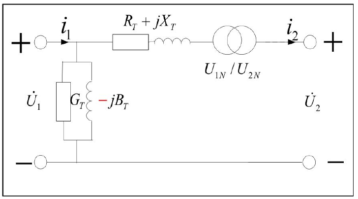
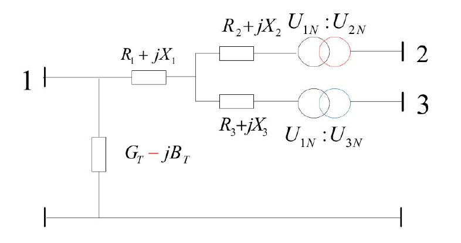
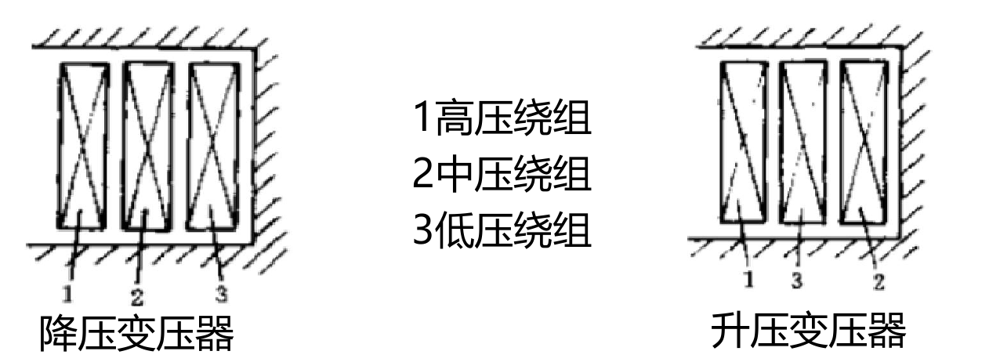
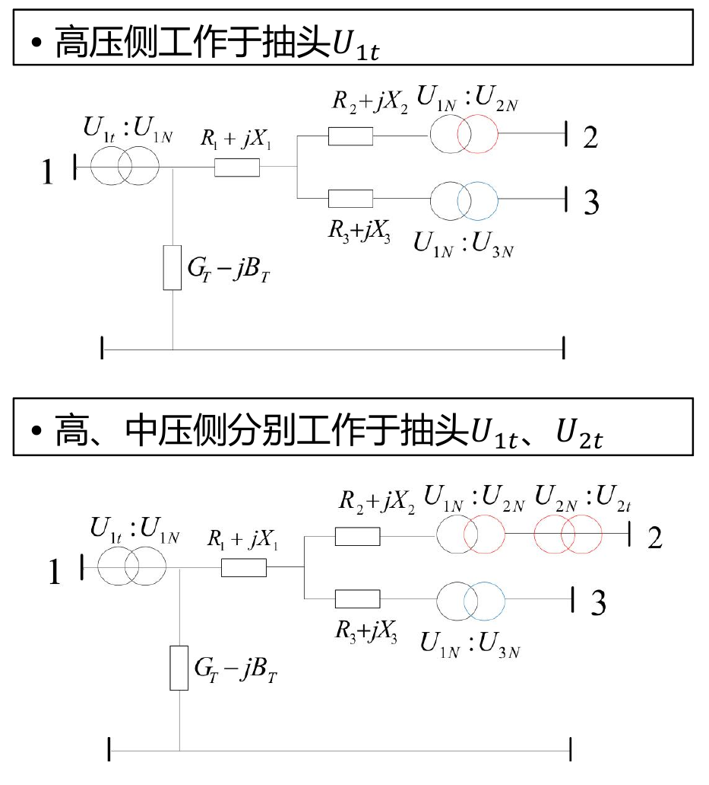
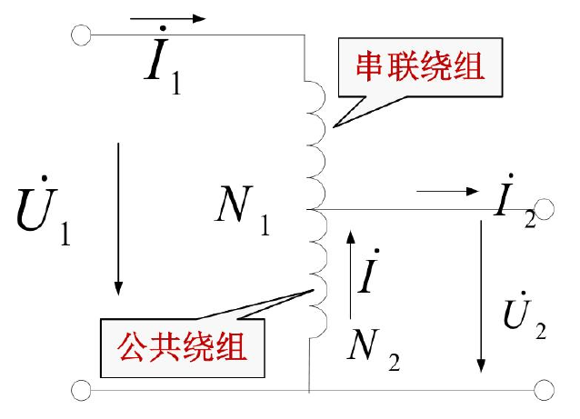
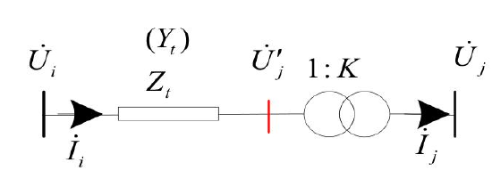
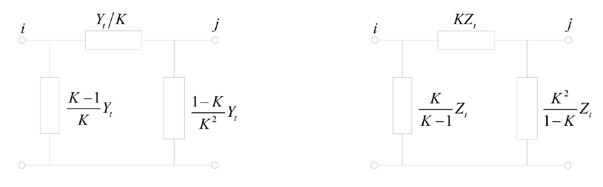

# 电气工程原理

## 引论与基本概念

### 电力系统简介

#### 电气技术发展

第一个直流输电系统由法国人德波里于 1882 年建成

- 电压 $1300\sim 850\ \mathrm{V}$
- 传输功率为 $1.5\ \mathrm{kW}$，效率为 $60\%$
- 传输距离为 $57\ \mathrm{km}$

##### 电力系统发展过程

有三条并行的发展路线

1. 简单系统 $\rightarrow$ 复杂系统 $\rightarrow$ 互联系统
2. 直流输电 $\rightarrow$ 交流输电 $\rightarrow$ 交直流输电
3. 小容量机组 $\rightarrow$ 大容量机组

#### 电力系统构成与表示

电力系统的定义为：完成电能**生产、输送、分配、消耗**的统一整体。主要由**发电机、变压器、电力线路和负荷**等电力设备组成的三相交流系统

组成上分为**一次系统**和**二次系统**，一次系统负责**输送和变换电能**，二次系统负责**监测、控制和保护一次系统**

- 一次系统
  - 直接参与电能生产、变换、输送、分配和使用的高电压电力网络
  - 工作在较高电压、电流等级
  - 直接承担电能传输
  - 存在**稳态运行**与**暂态运行**两种运行过程
  - 组成
    - **发电机**：生产电能，将一次能源转换为电能
    - **电力网**：电能的输送和分配，包括输电网和配电网
    - **负荷**：电能消耗，将电能转换为其他形式的能量
- 二次系统
  - 对一次系统进行**测量、监视、控制和保护**的低电压信息系统及其操作机构
  - 测量一次系统运行参数
  - 监视系统运行状态
  - 控制一次设备
  - 故障时进行继电保护
  - 保证一次系统**安全、可靠、经济运行**

电力系统中的基本参量

- 总装机容量
  - 系统中所有发电机组 **额定有功功率之和**
- 年发电量
  - 系统中所有发电机组全年实际发出电能的总和
- 最大负荷
  - 在规定时间范围内（一年、一月或一天），系统总有功负荷的最大值
- 年用电量
  - 所有用户全年消耗电能的总和
- 额定频率
  - 交流电力系统规定的标准频率：
    - 中国、欧洲、澳大利亚：$50\ \mathrm{Hz}$
    - 美国、加拿大： $60\ \mathrm{Hz}$
- 最高电压等级
  - 系统中最高电压等级线路的**额定电压**

#### 电力系统发展趋势

主要集中在**发电侧、输配电侧、运行机制和系统形态**四个方面

- 发电环节
  - 主要是能源结构转型
    - 开发可再生能源
    - 洁净煤技术
    - 多联产技术
  - 核心是从传统化学能源为主向情节、低碳、多元能源结构转变
- 输配电环节
  - 提高输电效率
  - 发展电子电力技术
- 运营机制改革
  - 电力市场化改革
  - 将传统的统一计划调度逐步转变为**市场竞争**配合**调度控制**
- 发展新型电力系统
  - 主要方向有智能电网，能源互联网等
  - 基本目标
    - 安全可靠、经济高效、清洁环保、透明开放、友好互动
  - 主要作用为
    - 推动新能源发电技术发展
    - 促进新型用能方式与输配电网的集成
    - 提高电网智能化水平
    - 增强用户互动

#### 我国电力系统

##### 发展历史

1. **$1882$ 年**：英国人在上海成立电气公司，建立中国第一座发电厂，装机容量约为 $12\ \mathrm{kW}$。

2. **$1949$ 年**：全国发电总装机容量为 $1849\ \mathrm{MW}$，年发电量为 $4.3\ \mathrm{TWh}$，分别位居世界第 $25$ 位和第 $21$ 位。

3. **$1980$ 年**：全国发电装机容量达到 $65869\ \mathrm{MW}$，年发电量达到 $300.6\ \mathrm{TWh}$，分别位居世界第 $8$ 位和第 $6$ 位。

4. **$2013$ 年**：全国发电装机容量跃居世界第 $1$ 位。

##### 6 大区域电网

- **东北电网**：辽宁、吉林、黑龙江。
- **华北电网**：北京、天津、河北、山西、山东。
- **华东电网**：上海、浙江、江苏、安徽、福建。
- **华中电网**：河南、江西、湖北、湖南、四川、重庆。
- **西北电网**：青海、甘肃、宁夏、陕西、新疆。
- **南方电网**：广东、广西、云南、贵州、海南、香港、澳门。

##### 国家电力公司

- **电网公司**：国家电网公司、中国南方电网有限责任公司。
- **发电公司**：中国华能集团公司、中国大唐集团公司、中国华电集团公司、中国国电集团公司、中国电力投资集团公司。
- **建设、咨询公司**：中国葛洲坝集团公司、中国水利水电建设集团公司、中国水电工程顾问集团公司、中国电力工程顾问集团公司。

### 电力系统的电压等级、接线方式

#### 电力系统的额定电压等级

额定电压是电力设备正常运行的工作电压

三相电力系统的有功功率为

$$
P = \sqrt{3}UI\cos\varphi
$$

因此当输电功率一定时，升高电压可以降低电流，从而减少线路损耗，提高输电效率

我国国家标准额定电压等级规定

| 电压等级                   | 大致用途           |
| -------------------------- | ------------------ |
| $3, 6, 10\ \mathrm{kV}$    | 中压配电、厂用电等 |
| $35,(60) 110\ \mathrm{kV}$ | 配电、区域输电     |
| $220\ \mathrm{kV}$         | 高压输电           |
| $330, 500\ \mathrm{kV}$    | 超高压输电         |
| $750\ \mathrm{kV}$         | 超高压输电         |
| $1000\ \mathrm{kV}$        | 特高压交流输电     |

#### 各设备额定电压

1. 线路额定电压

   $$
   U_\mathrm{LN}= \text{线路平均电压}=\frac{U_\mathrm{a}+U_\mathrm{b}}{2}=U_\mathrm{N}
   $$

2. 各用电设备额定电压

   $$
   U_\mathrm{N}
   $$

3. 发电机

   $$
   U_\mathrm{GN} = 1.05 U_\mathrm{N}
   $$

   用电设备允许电压偏移 $5\%$，而线路压降约为 $10\%$，此时发电机端的最低电压为 $95\%+10\%=105\%$

4. 变压器
   - 一次绕组
     - 直接连接发电机
       - 和发电机的额定电压相同，为 $1.05U_\mathrm{N}$
     - 连接输电线路
       - 认为是用电设备，为 $U_\mathrm{N}$
   - 二次绕组
     - 变压器二次绕组的额定电压为空载时的电压
     - 大多数情况下，二次绕侧相当于发电机，需要承担电路压降 $10\%$，并且内部具有阻抗导致电压降低 $5\%$，因此二次绕组的额定电压为 $0.95U_\mathrm{N}+10\%+5\%=1.10U_\mathrm{N}$
     - 对于阻抗很小的变压器，不需要考虑内部压降 $5\%$，因此二次绕组的额定电压为 $0.95U_\mathrm{N}+10\%=1.05U_\mathrm{N}$
     - 注意这里的 $U_\mathrm{N}$ 是指与相应绕组连接的线路的额定电压

- 主抽头是正常额定变比对应的位置
- 分接头是主抽头两边用于调节电压的位置
- 高压绕组有分接抽头

#### 电力系统的接线方式

##### 无备用接线方式

无备用接线方式指的是某个负荷通常只有唯一的供电路径，这条路径一旦发生永久故障，负荷通常就会停电。

优点是结构简单，投资少，运行维护方便，缺点是可靠性较差。

##### 有备用接线方式

有备用接线方式指的是一条 供电路径坏了还有另一条备用路径供电

但是会比较贵

#### 中性点接地方式

1. **定义**  
   电力系统中性点是指接入系统星形连接的变压器或发电机组的中性点。

2. **分类**
   1. 中性点直接接地（大接地电流系统）：$110\ \mathrm{kV}$ 及以上。
   2. 中性点不接地（小接地电流系统）：$60\ \mathrm{kV}$ 及以下。
   3. 中性点不接地（小接地电流系统）：$35\ \mathrm{kV}$ 及以下。
   4. 中性点经消弧线圈接地：
      - $3\sim6\ \mathrm{kV}$ 系统，容性电流超过 $30\ \mathrm{A}$；
      - $10\ \mathrm{kV}$ 系统，容性电流超过 $20\ \mathrm{A}$；
      - $35\ \mathrm{kV}$ 系统，容性电流超过 $10\ \mathrm{A}$。

### 发电厂及变电所类型

#### 发电厂类型

1. **火力发电厂**  
   以煤、石油、天然气、油页岩等为燃料。
   - 凝汽式汽轮机：主要用于供电；
   - 供热式汽轮机：既供电又供热，通常承担日负荷曲线的基荷；
   - 燃气轮机：主要用于调峰。

2. **水力发电厂**
   - 径流式：无库容，通常承担日负荷曲线的基荷；
   - 堤坝式（坝后式、河床式）：有库容，可用于调峰、调频；
   - 抽水蓄能：既可蓄水，又可发电，可用于调峰、调频、调相。

3. **核能发电厂**  
   通常承担基荷。

4. **其他可再生能源发电方式**  
   包括风力、光伏、地热、潮汐等。

#### 变电所的类型

变电所位于发电厂与用户之间，主要完成电能的**变换和分配**。

##### 按功能划分

1. **升压变电所**：提高电压，便于远距离输电。
2. **降压变电所**：降低电压，向下一级电网或用户供电。

##### 按在电力系统中的地位划分

1. **枢纽变电所**
   - 连接多个电压等级；
   - 汇集多个电源；
   - 电压等级通常为 $330\sim500\ \mathrm{kV}$；
   - 停电可能引起系统解列或瓦解。

2. **中间变电所**
   - 汇集 $2\sim3$ 个电源；
   - 电压等级通常为 $220\sim330\ \mathrm{kV}$；
   - 高压侧交换功率，低压侧向地区供电；
   - 停电可能引起电网解列。

3. **地区变电所**
   - 电压等级通常为 $110\sim220\ \mathrm{kV}$；
   - 向地区或中小城市用户供电；
   - 停电会导致该地区用户停电。

4. **终端变电所**
   - 位于输电线路终端，接近负荷点；
   - 电压等级通常为 $110\ \mathrm{kV}$；
   - 停电主要引起所供用户停电。

### 电力系统的运行与要求

#### 一、电力系统运行特点

1. **电力电量要求实时平衡**：电能无法实现大量储存，因此发电功率必须随负荷变化及时调整。

2. **运行工况改变迅速**：电力系统的负荷、潮流及运行状态变化较快。

3. **供电中断将造成重大损失**：停电可能影响生产、生活以及社会正常运行。

4. **电能质量要求严格**：系统运行时必须保证频率、电压和波形等指标满足要求。

#### 二、电力系统运行要求

电力系统运行的基本要求可以概括为：

$$
\boxed{\text{可靠、优质、经济}}
$$

##### 1. 运行的安全可靠性

1. 提高安全可靠性的主要措施：
   - 提高电网结构的强壮性；
   - 提高系统运行的稳定性；
   - 保证一定的备用容量，包括**有功备用**和**无功备用**。

2. 主要可靠性指标：
   - 设备连续运行年限；
   - 不停电概率；
   - 供电可靠率，如 $99.9\%$；
   - 用户平均停电时间；
   - 用户平均停电次数等。

##### 2. 电能质量

电能质量主要包括三个基本指标：**频率、电压、波形**。

1. **频率**
   - 系统频率取决于**有功功率平衡**；
   - 发电出力不足时，频率偏低；
   - 我国额定频率为

     $$
     f_N=50\ \mathrm{Hz}
     $$

   - 允许偏差约为

     $$
     \pm(0.2\sim0.5)\ \mathrm{Hz}
     $$

2. **电压**
   - 节点电压取决于**无功功率平衡**；
   - 无功不足时，电压偏低；
   - 一般允许电压偏移为额定值的

     $$
     \pm 5\%
     $$

   - 配电网允许偏差可为

     $$
     \pm(7\%\sim10\%)
     $$

3. **波形**
   - 波形质量问题主要由**谐波污染**引起；
   - 波形质量指标主要考察**畸变率是否超过给定值**。

##### 3. 运行经济性

1. 提高发电设备利用率，可用**发电设备利用小时数**衡量。

2. 降低系统运行消耗，包括：
   - 标准煤耗率；
   - 厂用电率；
   - 网损率（线损率）。

### 直流传输

- 线路电流 $i$
  $$
  i = \frac{u_1-u_2}{R}
  $$
- 线路始端电压 $u_1$
  $$
  u_1 = u_2 + ir
  $$
- 负荷消耗功率 $p_2$
  $$
  p_2 = u_2 i
  $$
- 输电线路始端功率 $p_1$
  $$
  p_1 = u_1 i
  $$
- 输电效率 $\eta$
  $$
  \eta = \frac{p_2}{p_1}\frac{u_2}{u_1}
  $$

### 交流传输

#### 单相系统

输电总功率 $P$

$$
P = UI
$$

可以写成时间的函数

$$
p(t) = u(t)i(t)
$$

其中

$$
\left\{
   \begin{aligned}
      &u(t) = u_\mathrm{m}sin\left(\omega t\right)\\
      &i(t) = i_\mathrm{m}sin\left(\omega t-\varphi\right)
   \end{aligned}
\right.
$$

$\varphi$ 为功率因数角

##### 瞬时功率计算

$$
\begin{aligned}
   p(t) = u(t)i(t) &= u_\mathrm{m}i_\mathrm{m}sin\left(\omega t\right)sin\left(\omega t-\varphi\right)\\
   &= \frac{1}{2}u_\mathrm{m}i_\mathrm{m}\left[cos\varphi-cos\left(2\omega t-\varphi\right)\right]\\
   &=UI\cos\varphi+UI\cos\left(2\omega t-\varphi\right)\\
\end{aligned}
$$

其中 $U = \frac{1}{\sqrt{2}}u_\mathrm{m}$，$I = \frac{1}{\sqrt{2}}i_\mathrm{m}$ 分别为电压和电流的有效值

##### 有功功率和无功功率

瞬时功率可以改写成

$$
p(t) = UI\cos\varphi\left(1-\cos\left(2\omega t\right)\right)+UI\sin\varphi\sin\left(2\omega t\right)
$$

可以令

- 有功功率 $P = UI\cos\varphi$ 单位为 $\mathrm{W}$
- 无功功率 $Q = UI\sin\varphi$ 单位为 $\mathrm{var}$

则

$$
p(t) = P\left(1-\cos\left(2\omega t\right)\right)+Q\sin\left(2\omega t\right)
$$

##### 视在功率和复功率

对于单相电路，视在功率 $S$ 为

$$
S = UI = \sqrt{P^2+Q^2}
$$

复功率为 $\dot{S}$ 为

$$
\dot{S} = \dot{U}\dot{I}^* = \mathrm{e}^{j\varphi_u} \cdot \mathrm{e}^{-j\varphi_i} = \mathrm{e}^{j\left(\varphi_u-\varphi_i\right)} = P +jQ
$$

#### 三相交流系统

对称三相交流系统由**对称三相电源**和**对称三相网络组成**

##### 对称三相电源

其中令

$$
\left\{
   \begin{aligned}
      &u_\mathrm{a} = U_\mathrm{m}sin\left(\omega t\right)\\
      &u_\mathrm{b} = U_\mathrm{m}sin\left(\omega t-\frac{2\pi}{3}\right)\\
      &u_\mathrm{c} = U_\mathrm{m}sin\left(\omega t+\frac{2\pi}{3}\right)
   \end{aligned}
\right.
$$

其相量表示为

$$
\left\{
   \begin{aligned}
      &\dot{U}_\mathrm{a} = U_\mathrm{m}\angle 0^\circ\\
      &\dot{U}_\mathrm{b} = U_\mathrm{m}\angle -120^\circ\\
      &\dot{U}_\mathrm{c} = U_\mathrm{m}\angle 120^\circ
   \end{aligned}
\right.
$$

线电压为（以 $U_\mathrm{ab}$ 为例）

$$
\dot{U}_\mathrm{ab} = \dot{U}_\mathrm{a}-\dot{U}_\mathrm{b} = \sqrt{3}\dot{U}_\mathrm{a}\angle 30^\circ
$$

三相的线电压大小都是一样的，为 $\sqrt{3}U$

表示相电压和相电流的瞬时值

$$
\left\{
   \begin{aligned}
      &u_\mathrm{a}(t) = \sqrt{2}U\sin\left(\omega t\right)\\
      &u_\mathrm{b}(t) = \sqrt{2}U\sin\left(\omega t-\frac{2\pi}{3}\right)\\
      &u_\mathrm{c}(t) = \sqrt{2}U\sin\left(\omega t-\frac{4\pi}{3}\right)
   \end{aligned}
\right.
$$

$$
\left\{
   \begin{aligned}
      & i_\mathrm{a}(t) = \sqrt{2}I\sin\left(\omega t-\varphi\right)\\
      & i_\mathrm{b}(t) = \sqrt{2}I\sin\left(\omega t-\frac{2\pi}{3}-\varphi\right)\\
      & i_\mathrm{c}(t) = \sqrt{2}I\sin\left(\omega t-\frac{4\pi}{3}-\varphi\right)
   \end{aligned}
\right.
$$

则三相电路的瞬时功率为

$$
\begin{aligned}
   P_\mathrm{3\varphi}(t) &= u_\mathrm{a}(t)i_\mathrm{a}(t)+u_\mathrm{b}(t)i_\mathrm{b}(t)+u_\mathrm{c}(t)i_\mathrm{c}(t)\\
   &= 2UI \left[\sin \left(\omega t \right)\sin \left(\omega t-\varphi\right)+ \sin \left(\omega t-\frac{2\pi}{3}\right)\sin \left(\omega t-\frac{2\pi}{3}-\varphi\right)+\sin \left(\omega t-\frac{4\pi}{3}\right)\sin \left(\omega t-\frac{4\pi}{3}-\varphi\right)\right]\\
   &= UI \left[\cos\varphi-cos\left(2\omega t-\varphi\right)+cos\varphi-cos\left(2\omega t-\frac{4\pi}{3}-\varphi\right)+cos\varphi-cos\left(2\omega t-\frac{8\pi}{3}-\varphi\right)\right]\\
   &= 3UI\cos\varphi\\
   &=3P_\varphi
\end{aligned}
$$

则对视在功率和复功率有

$$
\left\{
   \begin{aligned}
      &Q_\mathrm{3\varphi} = 3UI\sin\varphi=3Q_\varphi\\
      &S_\mathrm{3\varphi} = 3UI = 3S_\varphi
   \end{aligned}
\right.
$$

##### 三相对称网络三角形连接

令 $\dot{U}_\mathrm{ab} = U\angle 0$, $\dot{U}_\mathrm{bc} = U\angle -120^\circ$, $\dot{U}_\mathrm{ca} = U\angle -240^\circ$，则

相电流为

$$
\left\{
   \begin{aligned}
      &\dot{I}_\mathrm{a} = \frac{\dot{U}_\mathrm{ab}}{Z_\Delta} = \frac{U}{Z_\Delta}\angle -\varphi\\
      &\dot{I}_\mathrm{b} = \frac{\dot{U}_\mathrm{bc}}{Z_\Delta} = \frac{U}{Z_\Delta}\angle \left(-120^\circ-\varphi\right)\\
      &\dot{I}_\mathrm{c} = \frac{\dot{U}_\mathrm{ca}}{Z_\Delta} = \frac{U}{Z_\Delta}\angle \left(-240^\circ-\varphi\right)
   \end{aligned}
\right.
$$

线电流为

$$
\left\{
   \begin{aligned}
      &\dot{I}_\mathrm{a} =\dot{I}_\mathrm{ab} -\dot{I}_\mathrm{ca} =\sqrt{3}\dot{I}_\mathrm{ab}\angle -30^\circ\\
      &\dot{I}_\mathrm{b} =\dot{I}_\mathrm{bc} -\dot{I}_\mathrm{ab} =\sqrt{3}\dot{I}_\mathrm{bc}\angle -30^\circ\\
      &\dot{I}_\mathrm{c} =\dot{I}_\mathrm{ca} -\dot{I}_\mathrm{bc} =\sqrt{3}\dot{I}_\mathrm{ca}\angle -30^\circ
   \end{aligned}
\right.
$$

##### 对称Y型连接三相负载

$$
Z_\mathrm{Y} = \frac{1}{3}Z_\Delta
$$

##### 单相分析法

如果三相对称系统中所有的元件都是对称三相连接的，并且所有负载和电源都是星型连接的，组间无互感，则可以认为

- 网络中各对称元件的电流、电压矢量的相许与电源相同
- 所有元件的中性点电位相同，可以认为是零电位
- 各相可以完全解耦

注意这里的星型连接是可以由三角形连接通过星三角变换得到的

### 电力系统的标幺制

- 有名值：有具体物理单位的量值
- 标幺值：无具体物理单位的量值

$$
\mathrm{标幺值(per\  unit\  value)} = \frac{\mathrm{实际值(actual\  value)}}{\mathrm{基准值(base\ value)}}
$$

## 电力系统负荷的运行特性及数学模型

### 电力系统负荷与负荷曲线

#### 负荷的概念

负荷是指用户的用电设备所**消耗**的功率

负荷的分类

- 根据供电可靠性
  - 一级负荷
    - 对一级负荷中断供电，将可能造成生命危险、设备损坏、破坏生产过程
  - 二级负荷
    - 造成大量减产，交通停顿，使城镇居民生活收到影响
  - 三级负荷
    - 不属于一二级的停电影响不大的其他负荷
- 根据用户性质
  - 农业用电负荷
  - 工业用电负荷
  - 服务业用电负荷
  - 居民生活用电负荷
- 根据负荷发生的地点
  - 电力系统的总和用电负荷+电力系统网损
  - 电力系统供电负荷+厂用负荷
  - 电力系统发电负荷

#### 负荷曲线

##### 日负荷曲线

描述的是电力负荷在一日 $24$ 小时内的变化规律

几个概念

- 峰荷
  - 最小负荷水平线以下的部分
- 峰荷
  - 平均负荷水平线以上部分
- 腰荷
  - 基荷和峰荷之间部分

最小负荷系数

$$
\mathrm{最小负荷系数} = \frac{\mathrm{最小负荷}}{\mathrm{最大负荷}}
$$

负荷率

$$
\mathrm{负荷率} = \frac{\mathrm{平均负荷}}{\mathrm{最大负荷}}
$$

峰谷差率

$$
\mathrm{峰谷差率} = \frac{\mathrm{峰荷}-\mathrm{谷荷}}{\mathrm{谷荷}}
$$

红色的这条表示 Net Load，为

$$
\mathrm{Net\ Load} = \mathrm{Load}-\mathrm{Wind} - \mathrm{Solar}
$$

表示用户需求除去风电和光伏发电的剩余负荷需求，这一部分需要由传统的火电、水电、核电等可调节的发电机组来满足

从上图中可以看出，早晨和傍晚的时候净功率较大，压力较大

这样的曲线被称为鸭型曲线

##### 年最大负荷曲线

一年内每个小时统计得到的负荷曲线，按负荷大小从大到小排列，得到年负荷曲线

年最大负荷曲线描述一年内系统逐日或逐月的系统综合最大负荷的变化情况

系统装机容量需要大于系统综合最大值

##### 年持续负荷曲线

年持续负荷曲线是电力系统全年负荷按其大小及其持续运行时间的顺序排列成的曲线，可用于估算电力网全年用电量

年最大负荷利用小时数为全年总负荷在最大功率运行下的时间

$$
T_\mathrm{max} = \frac{A}{P_\mathrm{max}} = \frac{\int_0^{8760}P(tP\ \mathrm{d}t)}{P_\mathrm{max}}
$$

### 负荷特性

负荷特性是负荷功率随负荷端电压或系统频率而变化的的规律

分为静态特性和动态特性

静态特性是稳态时负荷功率与电压或频率的关系

$$
\left\{
   \begin{aligned}
      &P = F_p(U,f)\\
      &Q = F_q(U,f)
   \end{aligned}
\right.
$$

动态特性是在电压、频率变化过程中负荷功率随电压或频率的关系

$$
\left\{
   \begin{aligned}
      P &= \varphi_p\left(U,f,\frac{\partial U}{\partial t},
      \frac{\partial f}{\partial t},\frac{\partial U}{\partial f},\ldots\right)\\
      Q &= \varphi_q\left(U,f,\frac{\partial U}{\partial t},
      \frac{\partial f}{\partial t},\frac{\partial U}{\partial f},\ldots\right)
   \end{aligned}
\right.
$$

其中

- $\alpha = 0$ 是为恒定功率
- $\alpha = 1$ 是为恒定电流
- $\alpha = 2$ 是为恒定阻抗

#### 综合负荷数学模型

##### 恒定阻抗模型

阻抗为一个恒定值

$$
Z_\mathrm{LD} = \frac{U_\mathrm{LD}^2}{S_\mathrm{LD}}\left(\cos\varphi_\mathrm{LD}+j\sin\varphi_\mathrm{LD}\right)
$$

则功率与 $U^2$ 相关

##### 多项式模型

$$
\left\{
   \begin{aligned}
      &P=a_{p}U^{2}+b_{p}U+c_{p}\\
      &Q=a_{q}U^{2}+b_{q}U+c_{q}
   \end{aligned}
\right.
$$

以有功功率为例，其中 $a_pU^2$ 为恒定阻抗负荷，$b_pU$ 为恒定电流负荷，$c_p$ 为恒定功率负荷，$c_p$ 为恒定功率

可以理解为

$$
\text{负荷} = \text{恒阻抗部分} + \text{恒电流部分} + \text{恒功率部分}
$$

也将这个称为 ZIP 模型

- Z：Inpedence
- I：Current
- P：Power

##### 幂函数模型

$$
\left\{
   \begin{aligned}
      P &= P_0V^\alpha f^\varepsilon\\
      Q &= Q_0V^\beta f^\eta
   \end{aligned}
\right.
$$

## 输电线路

### 电力线路及结构

电力线路的作用为输送电能

- 分类
  - 按照电压等级分为：输电电路和配电电路
  - 按照结构分为：架空线路和电缆线路
- 构成
  - 导线
  - 避雷线
  - 绝缘子
  - 金具：支撑连接导线、固定在绝缘子上
  - 杆塔

#### 导线

- 作用
  - 传导电流
  - 输送电能
- 要求
  - 导电性能
  - 机械强度
  - 防腐蚀性能
- 材料
  - 铝、铝合金、铜和钢
- 结构
  - 单股线
  - 多股绞线
  - 钢芯铝绞线
  - 分裂导线
  - 扩径导线

关于导线型号

#### 避雷线

- 作用
  - 引雷电入大地
- 安装位置
  - 悬挂于杆塔顶部
- 安装原则
  - $35\ \mathrm{kV}$ 线路一般只在进出发电厂或变电站两端假设避雷线
  - $110\ \mathrm{kV}$ 及以上线路一般在全线设置避雷线
- 材料
  - 镀锌钢绞线

#### 绝缘子

- 针式绝缘子
  - 适用于 $35\ \mathrm{kV}$ 以下线路
- 瓷横担绝缘子
  - 适用于 $110\ \mathrm{kV}$ 及以下线路
  - 绝缘水平高，投资小
- 悬式绝缘子
  - 用于 $35\ \mathrm{kV}$ 及以上架空线路
  - 通常组装成绝缘子串使用

| 电压等级   | $35 \mathrm{kV}$ | $60 \mathrm{kV}$ | $110 \mathrm{kV}$ | $220 \mathrm{kV}$ | $330 \mathrm{kV}$ | $500 \mathrm{kV}$ |
| ---------- | ---------------: | ---------------: | ----------------: | ----------------: | ----------------: | ----------------: |
| 绝缘子片数 |                3 |                5 |                 7 |                13 |                19 |                24 |

#### 线路金具

金具是输电线路使用的金属部件总称，将绝缘子和架空电力线路悬挂并拉紧在杆塔上

#### 杆塔

- 作用
  - 支撑导线和避雷线
- 分类（按材料）
  - 木杆
  - 钢筋混泥土杆
  - 铁塔

#### 电缆

电缆的组成为

- 导体
  - L 或者 T
  - 单股或多股
  - 单相或三相
- 绝缘材料
  - 橡胶
  - 沥青
  - 聚氯乙烯
  - 棉麻
  - 绸
  - 纸
- 包护层
  - 内护层
    - 铅、铝、聚乙烯等，保护绝缘
  - 外护层
    - 防止锈蚀

### 输电线路参数

一根线路上有电流、有电压，就会出现四类效应：

| 发生的事情                   | 用什么参数表示       | 放在模型哪里 |
| ---------------------------- | -------------------- | ------------ |
| 导线发热，消耗有功功率       | 电阻 $r_1$           | 串联         |
| 电流产生磁场，储存磁场能量   | 电感，对应电抗 $x_1$ | 串联         |
| 绝缘泄漏、电晕等消耗有功功率 | 电导 $g_1$           | 并联         |
| 导线间及导线对地产生电场     | 电容，对应电纳 $b_1$ | 并联         |

#### 输电线路电阻

- 每相单位长度的电
  $$
  r_1 = \frac{\rho}{S}
  $$
- 多股绞线电阻
  $$
  r_n = \frac{K_p}{nS}
  $$
- 实际温度修正公式
  $$
  r_t = r_{20}\left[1+\alpha(t-20)\right]
  $$

注意，当通过交流电流时，电流在导线内部产生磁场，磁场发生变化导致导线截面内各点的电流密度不相同，产生集肤效应。导线内的电流分布不均，相当于交流电运输的面积更小，电阻相比于直流电阻会更大。

#### 电抗

电流产生磁场，通过磁场计算磁链，得到电感和电抗

##### 关键概念分析

###### 磁链

通过 $n$ 匝线圈的磁通量 $\Psi = n\Phi$ 称为**磁链**，单位为 $\mathrm{Wb}$

考虑两条平行的导线，则其中一条导线会有磁链，所以不一定要是线圈

###### 电感

单位电流能够产生的磁链成为电感

$$
L = \frac{\Psi}{I}
$$

单位为 $\mathrm{H}$

###### 电抗

交流电中的概念，类似电阻

不断变化的电流会产生变化的磁链

$$
\Psi(t) = Li(t)
$$

则由法拉第电磁感应定律，会产生感生电动势，这里假设 $L$ 为定值

$$
\epsilon = - \frac{\mathrm{d}\Psi}{\mathrm{d}t} = -L \frac{\mathrm{d}i}{\mathrm{d}t}
$$

对于正弦交流电有

$$
i = I_\mathrm{m}\sim(\omega t)
$$

带入则

$$
\epsilon = -\omega L I_\mathrm{m}\cos(\omega t)
$$

感应电压与 $\omega L$ 成正比，则定义感抗为

$$
X_\mathrm{L} = \omega L = 2\pi fL
$$

单位为 $\Omega$，容抗同理，为 $X_\mathrm{C} = -\frac{1}{\omega C}$，这里不做证明

##### 单根导线的磁链计算

考虑一条无限长的单根直导线上的长为 $l$ 的部分

分为导线内部和导线外部的磁链

###### 导线外部磁链计算

由安培环路定律计算，设距离导线中心为 $x$ 的磁场强度为 $H_x$

$$
\int H_x\cdot \  \mathrm{d}\vec{l} = i
$$

$$
H_x = \frac{i}{2\pi x}
$$

则磁感应强度为

$$
B_x = \mu_0 H_x = \frac{\mu_0 i }{2\pi x}
$$

计算从 $r$ 到 $D$ 的磁链

$$
\Psi = \int _r^D B_x\cdot l \  \mathrm{d}x = \frac{\mu_0i}{2\pi}l\frac{D}{r}
$$

###### 内部磁链

$$
\int H_x\cdot \  \mathrm{d}\vec{l} = \frac{\pi x^2}{\pi r^2}i
$$

可以计算得到

$$
H_x = \frac{x}{2\pi r^2}i
$$

$$
B_x = \frac{\mu_0 x}{2\pi r^2}i
$$

$$
\Psi = \int _0 ^r B_x \ \mathrm{d}S = \int \frac{\mu_0x}{2\pi r}i \cdot l(\mu_0x) \ \mathrm{d}x = \frac{\mu_0 i}{8\pi}l
$$

将外部磁链和内部磁链相加得到总磁链

$$
\Psi = \frac{\mu_0 i}{2\pi}\ln\frac{D}{r}+\frac{\mu_0 i}{8\pi} = \frac{\mu_0 i}{2\pi}\ln\frac{D}{e^{-\frac{1}{4}}r}=\frac{\mu_0 i}{2\pi}\ln\frac{D}{r'}
$$

这是对于单股导线的

对于多股导线，取 $r' =\left( 0.721\sim 0.771 \right)r$

对于钢芯铝绞线，取 $r' = 0.81r$

则可以计算出单根导线的电感和电抗为

$$
\left\{
   \begin{aligned}
      L &= \frac{\Psi}{i} = \frac{\mu_0}{2\pi}\ln\frac{D}{r'}\\
      X_\mathrm{L} &= 2\pi f L = \mu_0 f \ln\frac{D}{r'}
   \end{aligned}
\right.
$$

##### 输电线路电抗

###### $n$ 根导线磁链

对于 $n$ 根导线来说，假设 $L_{ij}$ 是导线 $j$ 对导线 $i$ 的磁链贡献系数，则导线 $i$ 的磁链为

$$
\boldsymbol{\psi} = \boldsymbol{L}\boldsymbol{i}
$$

其中

$$
\boldsymbol{\Psi} =
\begin{bmatrix}
  \Psi_1\\
  \Psi_2\\
  \ldots \\
  \Psi_i\\
  \ldots\\
  \Psi_n
\end{bmatrix}
$$

$$
\boldsymbol{L} =
\begin{bmatrix}
  L_{11} & L_{12} & \ldots & L_{1j} &\ldots& L_{1n}\\
  L_{21} & L_{22} & \ldots & L_{2j} &\ldots& L_{2n}\\
  \ldots & \ldots & \ldots & \ldots &\ldots& \ldots\\
  L_{i1} & L_{i2} & \ldots & L_{ij} &\ldots& L_{in}\\
  \ldots & \ldots & \ldots & \ldots &\ldots& \ldots\\
  L_{n1} & L_{n2} & \ldots & L_{nj} &\ldots& L_{nn}
\end{bmatrix}
$$

$$
\boldsymbol{i} =
\begin{bmatrix}
  i_1\\
  i_2\\
  \ldots \\
  i_i\\
  \ldots\\、
  i_n
\end{bmatrix}
$$

并且

$$
L_{ij} = \frac{\mu_0}{2\pi}\ln\frac{\mu_0}{D_{ij}}
$$

当 $i=j$ 时，$L_{ii} = \frac{\mu_0}{2\pi}\ln\frac{1}{r'}$

接下来进行证明

我们研究导线中的某一条导线 $i$，记周围的导线为 $j$，为了研究磁链，我们假设回路为导线 $i$ 和导线外部某点 $\mathrm{P}$ 构成的闭合回路，假设$\mathrm{P}$ 到导线 $i$ 的距离为 $D_{i\mathrm{P}}$，导线 $j$ 到导线 $i$ 的距离为 $D_{ji}$。后面令这个点趋向无穷远

则导线 $j$ 对导线 $i$ 的磁链贡献为

$$
\Psi_{ij} = \frac{\mu_0 i_j}{2\pi}\ln\frac{D_{j\mathrm{P}}}{D_{ji}}
$$

当 $j=i$ 是使用自身的全部磁链

$$
\Psi_{ii} = \frac{\mu_0 i_i}{2\pi}\ln\frac{D_{i\mathrm{P}}}{r'}
$$

我们将这些所有相加得到 $i$ 的总磁链

$$
\Psi_i = \sum_{j=1}^{n} \Psi_{ij} = \frac{\mu_0 i_i}{2\pi}\ln\frac{D_{i\mathrm{P}}}{r'} + \sum_{j\neq i} \frac{\mu_0 i_j}{2\pi}\ln\frac{D_{j\mathrm{P}}}{D_{ji}}
$$

可以将分子提取出来

$$
\Psi_i = \sum_{j=1}^n\frac{\mu_0i_j}{2\pi}\ln D_{j\mathrm{P}} + \sum_{j\neq i}\frac{\mu_0i_j}{2\pi} \ln \frac{1}{D_{ji}}+\frac{\mu_0i_i}{2\pi}\ln\frac{1}{r'}
$$

令 $D_{j\mathrm{P}} \to \infty$，则 $\ln D_{j\mathrm{P}}$ 趋于无穷大，可以近似为一个相同的值 $D$，则有

$$
 \sum_{j=1}^n\frac{\mu_0i_j}{2\pi}\ln D_{j\mathrm{P}} = \frac{\mu_0\ln D}{2\pi}\sum_{j=1}^n i_j
$$

有

$$
\sum_{j=1}^ni_j = 0
$$

则

$$
\Psi_i = \sum_{j\neq i}\frac{\mu_0i_j}{2\pi} \ln \frac{1}{D_{ji}}+\frac{\mu_0i_i}{2\pi}\ln\frac{1}{r'}
$$

记

$$
L_{ij} =

\left\{
   \begin{aligned}
      &\frac{\mu_0}{2\pi}\ln\frac{1}{D_{ji}}, && j \neq i\\
      &\frac{\mu_0}{2\pi}\ln\frac{1}{r'}, && j = i
   \end{aligned}
\right.
$$

则有

$$
\boldsymbol{\psi} = \boldsymbol{L}\boldsymbol{i}
$$

###### 三相对称线路磁链

三条导线的磁链分别为

$$
\left\{
   \begin{aligned}
      \Psi_\mathrm{a} &= Li_\mathrm{a}+Mi_\mathrm{b}+Mi_\mathrm{c}\\
      \Psi_\mathrm{b} &= Mi_\mathrm{a}+Li_\mathrm{b}+Mi_\mathrm{c}\\
      \Psi_\mathrm{c} &= Mi_\mathrm{a}+Mi_\mathrm{b}+Li_\mathrm{c}
   \end{aligned}
\right.
$$

其中 $L$ 和 $M$ 分别为自感和互感系数，可以由 $n$ 条导线的磁链计算公式得到

$$
\left\{
   \begin{aligned}
      L &= \frac{\mu_0}{2\pi}\ln\frac{1}{r'}\\
      M &= \frac{\mu_0}{2\pi}\ln\frac{1}{D}
   \end{aligned}
\right.
$$

将其带入，并且由 $i_\mathrm{a}+i_\mathrm{b}+i_\mathrm{c}=0$

得到

$$
\left\{
   \begin{aligned}
      \Psi_\mathrm{a}&=\left(L-M\right)i_\mathrm{a} = L_1i_a\\
      \Psi_\mathrm{b}&=\left(L-M\right)i_\mathrm{b} = L_1i_b\\
      \Psi_\mathrm{c}&=\left(L-M\right)i_\mathrm{c} = L_1i_c
   \end{aligned}
\right.
$$

其中 $L_1 = \frac{\mu_0}{2\pi}\ln\frac{D}{r'}$

在国内按照标准参数计算

$$
L_1 = 2\times 10^{-7} \ln\frac{D}{r'}\ \mathrm{H/m}
$$

按照这个计算电抗

$$
\begin{aligned}
   x_1 &= \omega L_1\\
       &= 0.06283\ln\frac{D}{r'}
       &= 0.06283\ln\frac{D}{r} +0.0157\ \mathrm{H/km}
       &=0.1445\lg \frac{D}{r'}\ \mathrm{H/km}
\end{aligned}
$$

经验数据

- $110/220\ \mathrm{kV}$ 线路 $x_1 = 0.4\mathrm{\omega/km}$
- $330/500\ \mathrm{kV}$ 线路 $x_1 = 0.18\mathrm{\omega/km}$

##### 三相不对称输电线路

使用[循环换位](https://archive.nptel.ac.in/content/storage2/courses/108104051/chapter_1/1_8.html)的思路

将输电线路划分为等长的三段，每个小段结束后轮换导线的位置，使得每项导线在各个位置各占据相同的时间，则电感变为平均值

$$
L_\mathrm{a} = L_\mathrm{b} = L_\mathrm{c} = \frac{1}{3}\left(L_\mathrm{ab}+L_\mathrm{bc}+L_\mathrm{ca}\right) = \frac{1}{3}\frac{\mu_0}{2\pi}\left(\ln\frac{D_\mathrm{ab}}{r'}+\ln\frac{D_\mathrm{bc}}{r'}+\ln\frac{D_\mathrm{ca}}{r'}\right) = \frac{\mu_0}{2\pi}\ln\frac{\sqrt[3]{D_\mathrm{ab}D_\mathrm{bc}D_\mathrm{ca}}}{r'}
$$

记 $D_\mathrm{eq}=\sqrt[3]{D_\mathrm{ab}D_\mathrm{bc}D_\mathrm{ca}}$，则可以写成通式

$$
L_\mathrm{a}=L_\mathrm{b}=L_\mathrm{c} = \frac{\mu_0}{2\pi}\ln\frac{D_\mathrm{eq}}{r'}
$$

##### 分裂导线电抗

每条分裂出来的导线的等效半径为

$$
R_\mathrm{s}=\sqrt[n]{r'nR^{n-1}}
$$

用复数证明

#### 输电线路电纳

电纳计算公式为

$$
B = 2\pi fC
$$

先计算 $C$

$$
E = \frac{q_0}{2\pi \varepsilon_0 x}
$$

$$
V = \int _r^D\frac{q}{2\pi\varepsilon_0 x} \, \mathrm{d}x = \frac{q}{2\pi\varepsilon_0}\ln\frac{D}{r}
$$

$$
C = \frac{q}{V} = \frac{2\pi\varepsilon_0}{\ln\left(\frac{D}{r}\right)}
$$

使用定义式求等效电容时需要求总电压，则等效电容为

$$
C_1 = \frac{2\pi\varepsilon_0}{\ln\left(\frac{D_\mathrm{eq}}{r}\right)}
$$

其中 $D_\mathrm{eq} = \sqrt[3]{D_\mathrm{ab}D_\mathrm{bc}D_\mathrm{ca}}$

则电纳的理想式为

$$
b_1 = \frac{2\pi f\cdot 2\pi\varepsilon_0}{\ln\left(\frac{D_\mathrm{eq}}{r}\right)} \ \mathrm{S/m} =\frac{7.58\times 10^{-6}}{\lg\frac{D_\mathrm{eq}}{r}}\ \mathrm{S/km}
$$

当导线离地面距离不是很高的时候还要考虑地面的影响

$$
b_1 = \frac{2\pi f\cdot 2\pi\varepsilon_0}{\ln\left(\frac{D_\mathrm{eq}}{r}\cdot\frac{\sqrt[3]{H_{aa'}H_{bb'}H_{cc'}}}{\sqrt[3]{H_{ab'}H_{bc'}H_{ca'}}}\right)} \ \mathrm{S/m} =\frac{7.58\times 10^{-6}}{\lg\left(\frac{D_\mathrm{eq}}{r}\cdot\frac{\sqrt[3]{H_{aa'}H_{bb'}H_{cc'}}}{\sqrt[3]{H_{ab'}H_{bc'}H_{ca'}}}\right)} \ \mathrm{S/km}
$$

##### 分裂导线电纳

只需要将 $r$ 替换为 $R_\mathrm{s}$ 即可，计算方式和电抗类似

$$
R_s = \sqrt[n]{rnR^{n-1}}
$$

#### 输电线路电导

当导线表面电场强度超过空气的击穿场强（标准状态下约 21.1 kV/cm 峰值）时，紧贴导线表面那一薄层空气被局部电离，这种现象叫作电晕

电晕中将电能转换为了光、热等能量，并且只与电压幅值有关，可以等效为并联电导

$$
g_1 =\frac{\Delta P_g}{U^2}
$$

其中 $\Delta P_g$ 为单位长度电晕导致的有功功率损耗

注意单位，若都是按照 $\mathrm{km}$ 计算的要乘 $1000$

一般来说可以忽略电晕的损耗，$g_1 = 0$

电晕起始电压（临界电压）$U_{cr}$ 为让导线表面场强刚好达到空气击穿场强的电压

$$
U_{cr} = 84\,m_1 m_2 \delta r f_m \lg \frac{D_{\mathrm{eq}}}{R_s}
$$

系数逐一解读：

| 系数                    | 名称               | 物理含义                                                       | 数值                                                                                                                             |
| ----------------------- | ------------------ | -------------------------------------------------------------- | -------------------------------------------------------------------------------------------------------------------------------- |
| $m_1$                   | 导线表面光滑系数   | 表面粗糙 $\rightarrow$ 局部场强集中 $\rightarrow$ 更容易电晕   | 光滑单导线 $0.85 \sim 0.9$；绞线更低；分裂导线 $\approx 0.9$                                                                     |
| $m_2$                   | 气象（天气）系数   | 雨、雾、雪、霜 $\rightarrow$ 水滴/冰晶尖端畸变电场             | **干燥晴朗** $= 1$，其他 $< 1$（雨雾约 $0.8$）                                                                                   |
| $\delta$                | 空气相对密度       | 海拔高、气温高 $\rightarrow$ 空气稀薄 $\rightarrow$ 击穿场强低 | $\delta = \dfrac{2.89\,p}{273 + t}$，$p$ 为大气压（$\mathrm{atm}$），$t$ 为摄氏温度（$^\circ\mathrm{C}$）；标准状态 $\delta = 1$ |
| $r$                     | 导线半径           | 半径越大 $\rightarrow$ 表面场强越低                            | 单位按教材约定（$\mathrm{cm}$／$\mathrm{mm}$）                                                                                   |
| $f_m$                   | 分裂导线系数       | 分裂使等效半径增大                                             | 单导线 $f_m = 1$                                                                                                                 |
| $D_{\mathrm{eq}} / R_s$ | 几何均距／等值半径 | 与电抗、电纳同一套量                                           | ——                                                                                                                               |

### 输电线路模型

对于一般的输电线路按照下图可以进行等效变换

假设一条线路长度为 $l$，输入段的电压电流分别为 $U_\mathrm{s}$ 和 $I_\mathrm{s}$，接收端的电压和电流分别为 $U_\mathrm{R}$ 和 $I_\mathrm{R}$

输电线路的单位长度的串联阻抗为 $z_1 = r_1+jx_1$，并联导纳为 $y_1 = g_1+jb_1$，则整条线路的总阻抗为 $Z = z_1l$，总导纳为 $Y = y_1l$

两个关键参数

- 线路传播系数 $\gamma = \sqrt{z_1y_1}$
- 波阻抗 $Z_\mathrm{c} = \sqrt{\frac{z_1}{y_1}}\approx\sqrt{x_1b_1}$

则传递方程为

$$
\begin{bmatrix}
  U_\mathrm{s}\\
  I_\mathrm{s}
\end{bmatrix}
=
\begin{bmatrix}
  \cosh{\gamma x} & Z_c\sinh{\gamma x}\\
  \frac{1}{Z_c}\sinh{\gamma x} & \cosh{\gamma x}
\end{bmatrix}
\begin{bmatrix}
  U_\mathrm{R}\\
  I_\mathrm{R}
\end{bmatrix}
$$

将其放入对称 $\pi$ 型等值电路中推导修正系数

$$
\begin{bmatrix} \dot U_1\\ \dot I_1 \end{bmatrix} = \begin{bmatrix} \displaystyle1+\frac{Z'Y'}{2} & Z'\\[6pt] \displaystyle\left(1+\frac{Z'Y'}{4}\right)Y' & \displaystyle1+\frac{Z'Y'}{2} \end{bmatrix} \begin{bmatrix} \dot U_2\\ \dot I_2 \end{bmatrix}
$$

则

$$
\left\{
   \begin{aligned}
       Z'&=Z*{\mathrm{c}}\mathrm{sh}(\gamma l) =Z\frac{\mathrm{sh}(\gamma l)}{\gamma l} \\
        Y' &=\frac{2[\mathrm{ch}(\gamma l)-1]} {Z*{\mathrm{c}}\mathrm{sh}(\gamma l)} =Y\frac{2[\mathrm{ch}(\gamma l)-1]} {\gamma l\,\mathrm{sh}(\gamma l)}
   \end{aligned}
\right.
$$

令 $Z' = K_1Z$，$Y' = K_2Y$

则

$$
\left\{
   \begin{aligned}
      K_1 &= \frac{\mathrm{sh}(\gamma l)}{\gamma l}\\
      K_2 &= \frac{2[\mathrm{ch}(\gamma l)-1]} {\gamma l\,\mathrm{sh}(\gamma l)}
   \end{aligned}
\right.
$$

将其在 $0$ 处使用 Taylor 展开，得到近似计算式

$$
\left\{
   \begin{aligned}
       K_1&\approx1+\frac{ZY}{6} \\
        K_2&\approx \frac{1+\dfrac{ZY}{12}} {1+\dfrac{ZY}{6}}
   \end{aligned}
\right.
$$

#### 均匀长线特性

当末端负载为波阻抗，即 $\displaystyle U_\mathrm{r}=Z_cI_\mathrm{r}$ 时，有

$$
\begin{bmatrix}
  U_\mathrm{x}\\
  I_\mathrm{x}
\end{bmatrix}
=
\begin{bmatrix}
  \cosh{\gamma x} & Z_c\sinh{\gamma x}\\
  \frac{1}{Z_c}\sinh{\gamma x} & \cosh{\gamma x}
\end{bmatrix}
\begin{bmatrix}
  U_\mathrm{r}\\
  I_\mathrm{r}
\end{bmatrix}
=
\begin{bmatrix}
  \cosh{\gamma x} & Z_c\sinh{\gamma x}\\
  \frac{1}{Z_c}\sinh{\gamma x} & \cosh{\gamma x}
\end{bmatrix}
\begin{bmatrix}
  Z_cI_\mathrm{r}\\
  I_\mathrm{r}
\end{bmatrix}
$$

则

$$
U_\mathrm{x} = Z_cI_\mathrm{r}\cosh{\gamma x}+Z_cI_\mathrm{r}\sinh{\gamma x} = Z_cI_\mathrm{r}\left(\cosh{\gamma x}+\sinh{\gamma x}\right) = Z_cI_\mathrm{r}e^{\gamma x}
$$

$$
I_\mathrm{x} = \frac{1}{Z_c}I_\mathrm{r}\sinh{\gamma x}+I_\mathrm{r}\cosh{\gamma x} = I_\mathrm{r}\left(\frac{1}{Z_c}\sinh{\gamma x}+\cosh{\gamma x}\right) = I_\mathrm{r}e^{\gamma x}
$$

因此线路上任意一点的电压和电流比都是波阻抗

##### 超高压输电线路的均匀长线特性

超高压输电线路的输电电阻 $R$ 远小于电抗 $X$，则单位长度的串联阻抗和并联导纳可以近似为

$$
\left\{
   \begin{aligned}
      z_1 &= r_1 + jx_1 \approx jx_1\\
      y_1 &= g_1 + jb_1 \approx jb_1
   \end{aligned}
\right.
$$

则波阻抗和传播系数可以近似为

$$
\left\{
   \begin{aligned}
      z_\mathrm{c} &= \sqrt{\frac{z_1}{y_1}} \approx \sqrt{\frac{jx_1}{jb_1}} = \sqrt{\frac{x_1}{b_1}}\\
      \gamma &= \sqrt{z_1y_1} \approx \sqrt{jx_1jb_1} = j\sqrt{x_1b_1}
   \end{aligned}
\right.
$$

则

$$
\left\{
   \begin{aligned}
      U_x & = e^{j\beta x}U_2\\
      I_x & = e^{j\beta x}I_2
   \end{aligned}
\right.
$$

- 线路各点的**电压幅值相等、电流幅值相等**，且同一点的电压、电流同相位。
- 线路任一段内的**磁场能量与电场能量相等**，即该段线路的无功功率损耗等于其产生的无功功率。
- 此时线路传输的功率，或负载消耗的功率，称为**线路自然功率**。

无损线路的自然功率公式为

$$
P_\mathrm{n}=\frac{U_\mathrm{N}^2}{Z_\mathrm{c}} =
$$

##### 传输效率

在末端负载等于波阻抗的条件下

$$
\left\{
   \begin{aligned}
      \dot U_x &=\mathrm{e}^{\gamma x}\dot U_\mathrm{r} =\mathrm{e}^{(\alpha+\mathrm{j}\beta)x}\dot U_\mathrm{r} =\mathrm{e}^{\alpha x}\mathrm{e}^{\mathrm{j}\beta x}\dot U_\mathrm{r}\\
      \dot I_x &=\mathrm{e}^{\gamma x}\dot I_\mathrm{r} =\mathrm{e}^{(\alpha+\mathrm{j}\beta)x}\dot I_\mathrm{r} =\mathrm{e}^{\alpha x}\mathrm{e}^{\mathrm{j}\beta x}\dot I_\mathrm{r}
   \end{aligned}
\right.
$$

取 $x=l$，始端与末端的功率分别为

$$
P_\mathrm{r}=U_\mathrm{r}I_\mathrm{r}\cos\varphi
$$

$$
P_\mathrm{s}=U_\mathrm{s}I_\mathrm{s}\cos\varphi =U_\mathrm{r}I_\mathrm{r}\mathrm{e}^{2\alpha l}\cos\varphi
$$

所以传输效率为

$$
\eta=\frac{P_\mathrm{r}}{P_\mathrm{s}} =\mathrm{e}^{-2\alpha l}
$$

- $\alpha>0$：有损耗线路，$\eta<1$。
- $\alpha=0$：无损耗线路，$\eta=1$，传输效率最高，传输功率为自然功率

## 三相变压器

### 三相变压器参数及等值电路

#### 变压器的分类

按照磁路系统分

- 单相变压器组
- 三相变压器
  - 三相三柱、四柱或五柱式

按照绕组数量分

- 双绕组
- 三绕组

按照升降压分

- 升压变压器
- 降压变压器

按照电磁耦合方式分

- 普通变压器
- 自耦变压器

按照调压方式分

- 无载调压
- 有载调压

按照绕组联结方式分

- Y0/Y-12
- Y/$\Delta$-11
- Y0/$\Delta$-11

其中 $\mathrm{Y}$ 为星形联结，$\Delta$ 为三角形联结，
$\mathrm{Y}_0$ 表示星形联结的中性点引出。
联结组中的数字使用**时钟表示法**，表示低压侧线电压相量相对高压侧的相位关系，
每个钟点对应 $30^\circ$，$12$ 点与 $0$ 点表示同相位。

#### 变压器的铭牌

铭牌给出了变压器的额定运行条件，以及计算等值电路所需要的试验数据

- **额定容量 $S_\mathrm{N}$**：三相变压器的总视在功率，通常以
  $\mathrm{kVA}$ 或 $\mathrm{MVA}$ 为单位。
- **额定电压 $U_\mathrm{N}$**：相应绕组的额定线电压。
  有调压抽头时，还会给出调压范围和每档的调节幅度。
- **额定电流 $I_\mathrm{N}$**：相应侧的额定线电流。
- **额定频率**：变压器规定的工作频率。
- **联结组标号**：表示各绕组的联结方式和相位关系。
- **短路阻抗、负载损耗、空载损耗和空载电流**：用于计算等值电路参数。
- **冷却方式**：例如油浸自冷和油浸风冷。

三相额定容量、电压和电流之间有

$$
S_\mathrm{N}=\sqrt{3}U_\mathrm{N}I_\mathrm{N}
$$

因此同一台双绕组变压器两侧的额定容量相同，但额定电流不同

$$
I_{1\mathrm{N}}=\frac{S_\mathrm{N}}{\sqrt{3}U_{1\mathrm{N}}},\qquad
I_{2\mathrm{N}}=\frac{S_\mathrm{N}}{\sqrt{3}U_{2\mathrm{N}}}
$$

三绕组变压器的三个绕组容量可以不同，需要分别检查各侧的额定电流限制。

#### 双绕组变压器

##### 等值电路

完整等值电路包括一次绕组阻抗、励磁支路和二次绕组阻抗。
将二次侧参数归算到一次侧后，可以得到 $\mathrm{T}$ 型等值电路。

电力系统计算中，通常将励磁支路移到输入端，并将两侧的漏阻抗合并，
得到简化的 $\Gamma$ 型等值电路

串联阻抗为

$$
Z_\mathrm{T}=R_\mathrm{T}+jX_\mathrm{T}
$$

其中

- $R_\mathrm{T}$：两侧绕组电阻归算到同一侧后的总电阻，反映**铜耗**。
- $X_\mathrm{T}$：两侧漏电抗归算到同一侧后的总电抗，反映**漏磁效应**。

励磁支路的导纳为

$$
Y_\mathrm{m}=G_\mathrm{T}-jB_\mathrm{T}
$$

- $G_\mathrm{T}$：反映铁芯中的**铁耗**。
- $B_\mathrm{T}$：励磁电纳的幅值，反映建立主磁通所需要的无功功率。

注意 $B_\mathrm{T}>0$ 表示这里取的是幅值。
由于励磁支路是感性的，导纳中的虚部为 $-B_\mathrm{T}$。

下面的参数都对应三相对称运行时的**每相星形等值电路**。
计算中使用三相总容量和线电压，即使实际绕组采用 $\Delta$ 联结，
也不能直接将所得参数当作某一实际绕组的阻抗。

##### 短路试验和空载试验

1. **短路试验**
   - 一侧绕组短接，在另一侧施加较低电压，使电流达到额定值。
   - 通常在高压侧加压，低压侧短接。
   - 测量短路损耗 $P_\mathrm{k}$ 和短路电压百分数 $U_\mathrm{k}\%$。
   - 此时磁通较小，可以忽略铁耗，认为短路损耗主要为铜耗。
   - 用于计算串联参数 $R_\mathrm{T}$ 和 $X_\mathrm{T}$。

2. **空载试验**
   - 一侧绕组开路，在另一侧施加额定电压。
   - 通常在低压侧加压，高压侧开路。
   - 测量空载损耗 $P_0$ 和空载电流百分数 $I_0\%$。
   - 此时电流较小，可以忽略铜耗，认为空载损耗主要为铁耗。
   - 用于计算并联参数 $G_\mathrm{T}$ 和 $B_\mathrm{T}$。

两种试验测得的数据，可以归算到任意一侧，但计算时要统一参考侧。

##### 变压器电阻

短路试验时，三相铜耗为

$$
P_\mathrm{k}=3I_\mathrm{N}^2R_\mathrm{T}
$$

将 $I_\mathrm{N}=S_\mathrm{N}/(\sqrt{3}U_\mathrm{N})$ 代入，得到

$$
R_\mathrm{T}=\frac{P_\mathrm{k}}{3I_\mathrm{N}^2}
=\frac{P_\mathrm{k}U_\mathrm{N}^2}{S_\mathrm{N}^2}
$$

这里使用的是 $\mathrm{W}$、$\mathrm{V}$、$\mathrm{VA}$，计算结果为 $\Omega$。

##### 变压器电抗

短路电压百分数定义为

$$
U_\mathrm{k}\%
=\frac{U_\mathrm{k}}{U_\mathrm{N}}\times100
=\frac{\sqrt{3}I_\mathrm{N}|Z_\mathrm{T}|}{U_\mathrm{N}}\times100
$$

因此

$$
|Z_\mathrm{T}|=\frac{U_\mathrm{k}\%}{100}
\frac{U_\mathrm{N}^2}{S_\mathrm{N}}
$$

电抗的计算式为

$$
X_\mathrm{T}=\sqrt{|Z_\mathrm{T}|^2-R_\mathrm{T}^2}
$$

电力变压器通常有 $R_\mathrm{T}\ll X_\mathrm{T}$，课件采用近似

$$
X_\mathrm{T}\approx |Z_\mathrm{T}|
=\frac{U_\mathrm{k}\%}{100}\frac{U_\mathrm{N}^2}{S_\mathrm{N}}
$$

##### 变压器电导和电纳

忽略空载铜耗，三相空载有功损耗为

$$
P_0\approx3\left(\frac{U_\mathrm{N}}{\sqrt{3}}\right)^2G_\mathrm{T}
=U_\mathrm{N}^2G_\mathrm{T}
$$

因此

$$
G_\mathrm{T}\approx\frac{P_0}{U_\mathrm{N}^2}
$$

空载电流百分数为 $I_0\%=100I_0/I_\mathrm{N}$，所以

$$
|Y_\mathrm{m}|=\frac{I_0}{U_\mathrm{N}/\sqrt{3}}
=\frac{I_0\%}{100}\frac{S_\mathrm{N}}{U_\mathrm{N}^2}
$$

电纳幅值为

$$
B_\mathrm{T}=\sqrt{|Y_\mathrm{m}|^2-G_\mathrm{T}^2}
$$

由于空载电流主要为励磁无功电流，课件采用近似

$$
B_\mathrm{T}\approx |Y_\mathrm{m}|
=\frac{I_0\%}{100}\frac{S_\mathrm{N}}{U_\mathrm{N}^2}
$$

##### 常用单位下的参数汇总

当试验数据使用以下单位时

- $P_\mathrm{k}$、$P_0$：$\mathrm{kW}$。
- $S_\mathrm{N}$：$\mathrm{MVA}$。
- $U_\mathrm{N}$：$\mathrm{kV}$。
- $U_\mathrm{k}\%$、$I_0\%$：百分数的数值。

参数计算式为

$$
\left\{
\begin{aligned}
R_\mathrm{T}
&=\frac{P_\mathrm{k}U_\mathrm{N}^2}{1000S_\mathrm{N}^2}
\quad (\Omega)\\
X_\mathrm{T}
&\approx\frac{U_\mathrm{k}\%\,U_\mathrm{N}^2}{100S_\mathrm{N}}
\quad (\Omega)\\
G_\mathrm{T}
&\approx\frac{P_0}{1000U_\mathrm{N}^2}
\quad (\mathrm{S})\\
B_\mathrm{T}
&\approx\frac{I_0\%\,S_\mathrm{N}}{100U_\mathrm{N}^2}
\quad (\mathrm{S})
\end{aligned}
\right.
$$

注意电阻和电导计算式中有 $1000$，电抗和电纳计算式中没有。
归算到哪一侧，就使用哪一侧的额定电压。

##### 变比和参数归算

变压器变比为两侧绕组**空载线电压之比**，主抽头下记为

$$
K_\mathrm{T}=\frac{U_{1\mathrm{N}}}{U_{2\mathrm{N}}}
$$

令两侧每相绕组的匝数分别为 $N_1$ 和 $N_2$，则

$$
K_\mathrm{T}=
\begin{cases}
\dfrac{N_1}{N_2},&\mathrm{Y/Y}\text{ 或 }\Delta/\Delta\\[6pt]
\sqrt{3}\dfrac{N_1}{N_2},&\mathrm{Y}/\Delta\\[6pt]
\dfrac{N_1}{\sqrt{3}N_2},&\Delta/\mathrm{Y}
\end{cases}
$$

因此**线电压变比不一定等于绕组匝数比**。
这里讨论变比的幅值，联结组引起的相位差另行处理。

将二次侧的每相星形等值参数归算到一次侧，有

$$
\left\{
\begin{aligned}
\dot U_2'&=K_\mathrm{T}\dot U_2\\
\dot I_2'&=\frac{\dot I_2}{K_\mathrm{T}}\\
Z_2'&=K_\mathrm{T}^2Z_2\\
Y_2'&=\frac{Y_2}{K_\mathrm{T}^2}
\end{aligned}
\right.
$$

可以从阻抗定义直接得到

$$
Z_2'=\frac{\dot U_2'}{\dot I_2'}
=K_\mathrm{T}^2\frac{\dot U_2}{\dot I_2}
=K_\mathrm{T}^2Z_2
$$

因此从一次侧归算到二次侧时，**阻抗除以变比的平方，导纳乘以变比的平方**。

##### 调压抽头的影响

若实际使用的抽头电压分别为 $U_{1\mathrm{t}}$ 和 $U_{2\mathrm{t}}$，则实际变比为

$$
K_\mathrm{T}=\frac{U_{1\mathrm{t}}}{U_{2\mathrm{t}}}
$$

当只有高压侧调节抽头时，令

$$
a=\frac{U_{1\mathrm{t}}}{U_{1\mathrm{N}}}
$$

按课件的近似，认为容量和试验百分数等数据不变。
将参数归算到实际高压抽头侧时

$$
Z_\mathrm{T}^{(1\mathrm{t})}
=a^2Z_\mathrm{T}^{(1\mathrm{N})},\qquad
Y_\mathrm{m}^{(1\mathrm{t})}
=\frac{Y_\mathrm{m}^{(1\mathrm{N})}}{a^2}
$$

如果低压侧抽头不变，归算到低压侧的参数在这一近似下不变。
这是课件采用的模型假设，实际试验数据随抽头变化时，应使用相应档位的数据。

#### 三绕组变压器

##### 等值电路和试验

将三个绕组依次记为 $1$ 高压侧、$2$ 中压侧、$3$ 低压侧，
并将全部参数归算到同一电压侧，可以得到**星形等值电路**

三个等值支路的阻抗分别为

$$
Z_1=R_1+jX_1,\qquad Z_2=R_2+jX_2,\qquad Z_3=R_3+jX_3
$$

励磁支路仍使用 $G_\mathrm{T}-jB_\mathrm{T}$。
归算到高压侧时，中、低压侧还通过理想变压器恢复到各自的实际电压等级。

- **短路试验**：分别在 $1$—$2$、$1$—$3$、$2$—$3$ 绕组间进行，
  每次将一个绕组短接，在另一个绕组加压，剩余绕组开路。
- **空载试验**：在一个绕组加额定电压，其余两个绕组开路。
  励磁支路的参数计算方式与双绕组变压器相同。

两两短路试验测得的是两个等值支路阻抗之和

$$
\left\{
\begin{aligned}
Z_{12}&=Z_1+Z_2\\
Z_{13}&=Z_1+Z_3\\
Z_{23}&=Z_2+Z_3
\end{aligned}
\right.
$$

因此不能直接将某次两绕组间的试验数据当作单个支路的参数。

##### 电阻参数计算

首先将三个短路损耗都统一到**同一容量、同一参考侧的电流基准**。
此时可以写成

$$
\left\{
\begin{aligned}
P_{\mathrm{k}12}&=P_{\mathrm{k}1}+P_{\mathrm{k}2}\\
P_{\mathrm{k}13}&=P_{\mathrm{k}1}+P_{\mathrm{k}3}\\
P_{\mathrm{k}23}&=P_{\mathrm{k}2}+P_{\mathrm{k}3}
\end{aligned}
\right.
$$

解得各支路对应的损耗

$$
\left\{
\begin{aligned}
P_{\mathrm{k}1}
&=\frac{P_{\mathrm{k}12}+P_{\mathrm{k}13}-P_{\mathrm{k}23}}{2}\\
P_{\mathrm{k}2}
&=\frac{P_{\mathrm{k}12}+P_{\mathrm{k}23}-P_{\mathrm{k}13}}{2}\\
P_{\mathrm{k}3}
&=\frac{P_{\mathrm{k}13}+P_{\mathrm{k}23}-P_{\mathrm{k}12}}{2}
\end{aligned}
\right.
$$

设全部参数归算到侧 $q$，该侧额定线电压为 $U_{q\mathrm{N}}$，则

$$
R_i=\frac{P_{\mathrm{k}i}U_{q\mathrm{N}}^2}{1000S_\mathrm{N}^2}
\quad (\Omega),\qquad i=1,2,3
$$

这里 $P_{\mathrm{k}i}$ 用 $\mathrm{kW}$，$U_{q\mathrm{N}}$ 用 $\mathrm{kV}$，
$S_\mathrm{N}$ 用 $\mathrm{MVA}$，三个支路都使用同一个归算电压。

##### 电抗参数计算

在忽略电阻对短路阻抗幅值影响的近似下，将三个短路电压百分数分解

$$
\left\{
\begin{aligned}
U_{\mathrm{k}1}\%
&=\frac{U_{\mathrm{k}12}\%+U_{\mathrm{k}13}\%-U_{\mathrm{k}23}\%}{2}\\
U_{\mathrm{k}2}\%
&=\frac{U_{\mathrm{k}12}\%+U_{\mathrm{k}23}\%-U_{\mathrm{k}13}\%}{2}\\
U_{\mathrm{k}3}\%
&=\frac{U_{\mathrm{k}13}\%+U_{\mathrm{k}23}\%-U_{\mathrm{k}12}\%}{2}
\end{aligned}
\right.
$$

各支路的电抗为

$$
X_i\approx\frac{U_{\mathrm{k}i}\%\,U_{q\mathrm{N}}^2}{100S_\mathrm{N}}
\quad (\Omega),\qquad i=1,2,3
$$

这里的 $U_{\mathrm{k}i}\%$ 是分解得到的等值参数，
并不是单独对某个绕组测得的短路电压。

若需要考虑电阻，应先分别计算各两绕组间的电抗

$$
X_{ij}=\sqrt{|Z_{ij}|^2-R_{ij}^2}
$$

再对 $X_{12}$、$X_{13}$、$X_{23}$ 使用相同的半和半差关系，得到 $X_1$、$X_2$、$X_3$。

##### 容量比的影响

三个绕组额定容量不同时，两两短路试验的电流受到**较小容量绕组**的限制。
因此试验损耗不一定是在统一的额定电流下测得的。

设某对绕组的损耗 $P'_{\mathrm{k}ij}$ 是在容量基准 $S_{ij}$ 下测得的，
将其换算到统一容量 $S_\mathrm{N}$，由铜耗与电流平方成正比得到

$$
P_{\mathrm{k}ij}=P'_{\mathrm{k}ij}
\left(\frac{S_\mathrm{N}}{S_{ij}}\right)^2
$$

应当**先归算容量，再分解损耗**，最后计算各支路电阻。

课件说明，普通三绕组变压器制造厂给出的短路电压百分数，
已归算到规定的变压器额定电流，所以不需要再次进行容量归算。
这一点要根据数据说明判断，不能对已经归算的数据重复换算。

如果使用的短路电压百分数仍以试验容量为基准，在电压基准不变时应换算为

$$
U_{\mathrm{k}ij}\%
=U'_{\mathrm{k}ij}\%\frac{S_\mathrm{N}}{S_{ij}}
$$

注意两种换算的区别：**短路损耗乘容量比的平方，短路电压百分数乘容量比**。

##### 绕组排列和负电抗

课件中的绕组排列为

- 降压变压器：高压、中压、低压，中压绕组位于中间。
- 升压变压器：高压、低压、中压，低压绕组位于中间。

位于中间的绕组，其星形等值支路电抗往往较小，甚至为负值。
这是由两两漏电抗分解形成的**等值效应**，不能把负电抗支路当作实际电容。

##### 参数归算和调压抽头

归算到高压、中压或低压侧时，三个支路都分别使用
$U_{1\mathrm{N}}$、$U_{2\mathrm{N}}$ 或 $U_{3\mathrm{N}}$ 计算。

从侧 $p$ 归算到侧 $q$，有

$$
Z_i^{(q)}=Z_i^{(p)}
\left(\frac{U_{q\mathrm{N}}}{U_{p\mathrm{N}}}\right)^2,
\qquad i=1,2,3
$$

励磁导纳按电压比平方的倒数归算。

调压抽头也可以通过附加理想变压器表示

- 高压侧使用抽头 $U_{1\mathrm{t}}$：在高压侧增加
  $U_{1\mathrm{t}}:U_{1\mathrm{N}}$ 的理想变压器。
- 中压侧也使用抽头 $U_{2\mathrm{t}}$：在中压侧再增加
  $U_{2\mathrm{N}}:U_{2\mathrm{t}}$ 的理想变压器。

图中的阻抗保留在原来的归算侧。
如果将阻抗越过附加理想变压器移动到实际抽头侧，还需要按变比平方归算，
不能既改变阻抗的参考侧，又重复计入同一个抽头的变比作用。

#### 自耦变压器

##### 结构和运行特性

自耦变压器的高、低压侧共用一部分绕组，分为**串联绕组**和**公共绕组**

两侧既有磁耦合，又有直接的电气连接。

先按单相或每相讨论，设 $U_1>U_2$，
$N_1$ 为高压侧总匝数，$N_2$ 为公共绕组匝数，串联绕组匝数为 $N_1-N_2$。

理想情况下

$$
K_\mathrm{A}=\frac{U_1}{U_2}=\frac{N_1}{N_2}=\frac{I_2}{I_1}
$$

按照图中的电流方向，公共绕组电流为

$$
\dot I=\dot I_2-\dot I_1
$$

因此串联绕组承受电压 $U_1-U_2$，流过电流 $I_1$；
公共绕组承受电压 $U_2$，流过电流 $I_2-I_1$。

##### 额定容量、电磁容量和传导容量

额定容量由对外传输的总视在功率决定

$$
S_\mathrm{N}=U_1I_1=U_2I_2
$$

其中只有一部分通过电磁感应传递，称为**电磁容量**

$$
S_\mathrm{M}=(U_1-U_2)I_1=U_2(I_2-I_1)
$$

另一部分通过直接的电气连接传递，称为**传导容量**

$$
S_\mathrm{C}=U_2I_1
$$

所以

$$
S_\mathrm{N}=S_\mathrm{M}+S_\mathrm{C}
$$

效益系数定义为电磁容量与额定容量之比

$$
\alpha=\frac{S_\mathrm{M}}{S_\mathrm{N}}
=\frac{U_1-U_2}{U_1}
=1-\frac{1}{K_\mathrm{A}}
$$

三相对称运行时，将每相的容量乘 $3$，上述容量比例关系不变。

变比越接近 $1$，电磁容量占总容量的比例越小，节省材料的效果越明显。
这里的效益系数不是能量转换效率，不能与效率 $\eta$ 混淆。

##### 特点

- 两侧同时具有磁联系和电气联系，不能实现高、低压侧的电气隔离。
- 电力系统用自耦变压器的公共中性点通常直接接地。
- 常设置容量较小的第三绕组，采用 $\Delta$ 联结，
  为三倍频谐波电流提供内部通路，减小其对外部电压波形的影响。
- 相同额定容量下，所需的电磁容量较小，因此耗材少、损耗小。

##### 参数计算

带第三绕组的自耦变压器，可以按三绕组变压器的方法计算等值参数。
其中 $1$、$2$ 为自耦连接的高、中压侧，$3$ 为容量较小的第三绕组。

当涉及第三绕组的原始试验数据以其容量 $S_3$ 为基准时，
先统一到额定容量 $S_\mathrm{N}$

$$
\left\{
\begin{aligned}
P_{\mathrm{k}23}
&=P'_{\mathrm{k}23}\left(\frac{S_\mathrm{N}}{S_3}\right)^2\\
P_{\mathrm{k}13}
&=P'_{\mathrm{k}13}\left(\frac{S_\mathrm{N}}{S_3}\right)^2\\
U_{\mathrm{k}23}\%
&=U'_{\mathrm{k}23}\%\frac{S_\mathrm{N}}{S_3}\\
U_{\mathrm{k}13}\%
&=U'_{\mathrm{k}13}\%\frac{S_\mathrm{N}}{S_3}
\end{aligned}
\right.
$$

其余步骤与三绕组变压器相同。
如果提供的数据已经统一容量基准，则不再重复归算。

### 变压器非标准变比的等值电路

#### 变比的方向和非标准变比

前面 $K_\mathrm{T}$ 定义为一次侧与二次侧的空载线电压比。
下面按课件电路图的 **$1:K$** 定义变比，
即理想变压器右侧电压是左侧电压的 $K$ 倍。
课件部分文字的变比方向与图示不一致，这里以图示和电压、电流关系为准。

设两端为 $i$、$j$，标准变比和实际变比分别为

$$
K_\mathrm{a}=\frac{U_{j\mathrm{N}}}{U_{i\mathrm{N}}},\qquad
K_\mathrm{b}=\frac{U_{j\mathrm{t}}}{U_{i\mathrm{t}}}
$$

若 $i$ 为一次侧、$j$ 为二次侧，则这里的 $K_\mathrm{b}=1/K_\mathrm{T}$。
**变比的方向必须与电路图一致**，不能直接混用互为倒数的变比。

实际变比可以分解为标准部分和抽头引起的偏离

$$
K_\mathrm{b}=K_*K_\mathrm{a},\qquad
K_*=\frac{K_\mathrm{b}}{K_\mathrm{a}}
=\frac{U_{j\mathrm{t}}/U_{j\mathrm{N}}}
{U_{i\mathrm{t}}/U_{i\mathrm{N}}}
$$

- $K_*=1$：标准变比。
- $K_*\neq1$：非标准变比。

如果两侧仍使用各自的实际电压，可以用 $K=K_\mathrm{b}$ 建立等值电路。
如果已经按额定电压比统一电压等级，标准变比部分被消去，
剩下的理想变压器变比为 $K=K_*$。

因此标准变比不意味着两侧实际电压相等，而是归算后剩余变比为 $1$。
以下先讨论实数正变比，不计联结组带来的相移。

#### 电压、电流关系推导

暂时忽略励磁支路，将串联阻抗 $Z_\mathrm{t}$ 放在理想变压器的 $i$ 侧

令串联阻抗右端、理想变压器左端的电压为 $\dot U_j'$。
电流 $\dot I_i$ 从 $i$ 端流入，$\dot I_j$ 从 $j$ 端流出。

由理想变压器关系和串联支路电压降

$$
\left\{
\begin{aligned}
\dot I_i&=K\dot I_j\\
\dot U_j'&=\frac{\dot U_j}{K}\\
\dot U_i&=\dot U_j'+Z_\mathrm{t}\dot I_i
\end{aligned}
\right.
$$

可以得到

$$
\left\{
\begin{aligned}
\dot I_i&=\frac{\dot U_i}{Z_\mathrm{t}}
-\frac{\dot U_j}{KZ_\mathrm{t}}\\
\dot I_j&=\frac{\dot U_i}{KZ_\mathrm{t}}
-\frac{\dot U_j}{K^2Z_\mathrm{t}}
\end{aligned}
\right.
$$

写成矩阵形式

$$
\begin{bmatrix}
\dot I_i\\
\dot I_j
\end{bmatrix}
=
\begin{bmatrix}
\dfrac{1}{Z_\mathrm{t}}&-\dfrac{1}{KZ_\mathrm{t}}\\[6pt]
\dfrac{1}{KZ_\mathrm{t}}&-\dfrac{1}{K^2Z_\mathrm{t}}
\end{bmatrix}
\begin{bmatrix}
\dot U_i\\
\dot U_j
\end{bmatrix}
$$

第二行的符号与 $j$ 端电流取流出方向有关。
若将两端电流都定义为流入电路，则用 $-\dot I_j$ 替换第二个电流，
相应导纳矩阵变为对称矩阵。

#### $\pi$ 型等值电路

用三个导纳支路代替串联阻抗和理想变压器：
两端之间为 $y_{ij}$，$i$ 端对地为 $y_{i0}$，$j$ 端对地为 $y_{j0}$。

按照前面的电流方向，节点方程为

$$
\left\{
\begin{aligned}
\dot I_i&=y_{i0}\dot U_i+y_{ij}(\dot U_i-\dot U_j)\\
\dot I_j&=y_{ij}(\dot U_i-\dot U_j)-y_{j0}\dot U_j
\end{aligned}
\right.
$$

令

$$
Y_\mathrm{t}=\frac{1}{Z_\mathrm{t}}
$$

注意这里的 $Y_\mathrm{t}$ 是**串联阻抗的倒数**，与励磁导纳 $Y_\mathrm{m}$ 不同。

将节点方程与变压器的电压、电流关系逐项比较，得到

$$
\left\{
\begin{aligned}
y_{i0}+y_{ij}&=Y_\mathrm{t}\\
y_{ij}&=\frac{Y_\mathrm{t}}{K}\\
y_{ij}+y_{j0}&=\frac{Y_\mathrm{t}}{K^2}
\end{aligned}
\right.
$$

因此 $\pi$ 型等值电路的三个支路导纳为

$$
\left\{
\begin{aligned}
y_{ij}&=\frac{Y_\mathrm{t}}{K}\\
y_{i0}&=\frac{K-1}{K}Y_\mathrm{t}\\
y_{j0}&=\frac{1-K}{K^2}Y_\mathrm{t}
\end{aligned}
\right.
$$

取倒数，可以写成支路阻抗

$$
\left\{
\begin{aligned}
z_{ij}&=KZ_\mathrm{t}\\
z_{i0}&=\frac{K}{K-1}Z_\mathrm{t}\\
z_{j0}&=\frac{K^2}{1-K}Z_\mathrm{t}
\end{aligned}
\right.
$$

当 $K\neq1$ 时，还可以验证

$$
z_{i0}+z_{ij}+z_{j0}
=\left(\frac{K}{K-1}+K+\frac{K^2}{1-K}\right)Z_\mathrm{t}
=0
$$

$\pi$ 型电路消去了显式的理想变压器，便于按普通节点导纳进行网络计算。
其中对地支路用于反映变比的作用，不代表实际存在的对地元件。

#### 对地支路的性质

当 $K=1$ 时

$$
y_{i0}=y_{j0}=0,\qquad y_{ij}=Y_\mathrm{t}
$$

两个对地支路都开路，只剩下原来的串联阻抗。
此时应使用导纳形式判断，不能直接代入含有 $K-1$ 分母的阻抗表达式。

对于电力变压器，通常有 $R_\mathrm{T}\ll X_\mathrm{T}$，所以

$$
Z_\mathrm{t}\approx jX_\mathrm{T},\qquad
Y_\mathrm{t}\approx-\frac{j}{X_\mathrm{T}}
$$

由各支路的虚部，可以判断其等值性质

| 变比 | $i$ 端对地支路 | $j$ 端对地支路 |
| --- | --- | --- |
| $K>1$ | 感性，阻抗虚部为正 | 容性，阻抗虚部为负 |
| $0<K<1$ | 容性，阻抗虚部为负 | 感性，阻抗虚部为正 |
| $K=1$ | 开路 | 开路 |

这里的感性、容性是等值电路的性质。
不能将其中的负阻抗理解成变压器内部真实存在的电容或负电阻。

如果需要考虑空载损耗和励磁无功，应另加励磁支路，
不能把变比形成的对地支路当作励磁支路。

#### 阻抗归算到另一侧

前面的公式要求 $Z_\mathrm{t}$ 位于 $1:K$ 理想变压器的左侧。
若将阻抗移到右侧，记为 $Z_\mathrm{t}'$，则

$$
Z_\mathrm{t}'=K^2Z_\mathrm{t},\qquad
Y_\mathrm{t}'=\frac{1}{Z_\mathrm{t}'}
=\frac{Y_\mathrm{t}}{K^2}
$$

将 $Z_\mathrm{t}=Z_\mathrm{t}'/K^2$ 代入原来的支路公式，得到

$$
\left\{
\begin{aligned}
z_{ij}&=\frac{Z_\mathrm{t}'}{K}\\
z_{i0}&=\frac{Z_\mathrm{t}'}{K(K-1)}\\
z_{j0}&=\frac{Z_\mathrm{t}'}{1-K}
\end{aligned}
\right.
$$

相应的导纳为

$$
\left\{
\begin{aligned}
y_{ij}&=KY_\mathrm{t}'\\
y_{i0}&=K(K-1)Y_\mathrm{t}'\\
y_{j0}&=(1-K)Y_\mathrm{t}'
\end{aligned}
\right.
$$

因此必须同时检查**阻抗的归算侧**和**变比的方向**，
不能将右侧归算的阻抗直接代入左侧阻抗对应的公式。

#### 三绕组变压器的 $\pi$ 型等值电路

三绕组变压器仍从星形等值电路出发，保留三个等值阻抗和公共内部节点。
对含有理想变压器的支路，分别使用前面的 $\pi$ 型等值变换。

设公共内部节点为 $o$，其中一条支路为 $Z_r$ 串联一个 $1:K_r$ 的理想变压器，
连接外部端点 $r$，并且 $Z_r$ 已归算到节点 $o$ 一侧。
令 $Y_r=1/Z_r$，则该支路可以替换为

$$
\left\{
\begin{aligned}
y_{or}&=\frac{Y_r}{K_r}\\
y_{o0}^{(r)}&=\frac{K_r-1}{K_r}Y_r\\
y_{r0}&=\frac{1-K_r}{K_r^2}Y_r
\end{aligned}
\right.
$$

其中

- $y_{or}$：节点 $o$ 与端点 $r$ 之间的串联支路。
- $y_{o0}^{(r)}$：这一支路在公共节点 $o$ 形成的对地导纳。
- $y_{r0}$：这一支路在外部端点 $r$ 形成的对地导纳。

各支路在公共节点形成的对地导纳可以相加。
若某条支路的阻抗在理想变压器另一侧，应先归算，或者使用另一侧阻抗的公式。
励磁支路仍按原等值电路的位置保留。

计算时的顺序为

1. 将两两试验数据统一容量和电压基准。
2. 计算三个星形等值阻抗和励磁参数。
3. 按各侧实际抽头设置标准变比与非标准变比。
4. 明确每个阻抗的位置，逐支路变换为 $\pi$ 型电路。
5. 合并同一节点的对地导纳，建立节点方程。
